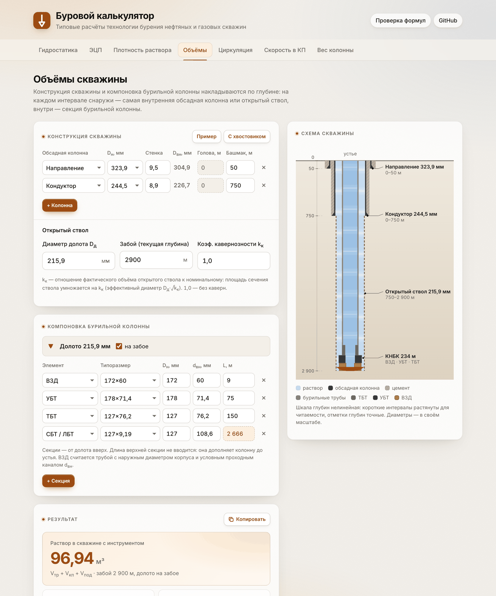

# 🛢️ Буровой калькулятор

Веб-калькулятор типовых расчётов технологии бурения нефтяных и газовых скважин: гидростатическое давление, ЭЦП, плотность раствора по пластовому давлению с нормативной репрессией, объёмы скважины по конструкции (направление, кондуктор, технические колонны, хвостовик, открытый ствол) и компоновке бурильной колонны, время циркуляции, скорость восходящего потока и вес колонны в растворе. Каждый расчёт показывает формулу с подставленными числами, так что результат можно проверить вручную. Чистый HTML/CSS/JS, без фреймворков и сборки; формулы вынесены в отдельный модуль и покрыты контрольными примерами.

**Демо:** https://xarebovdavid.github.io/drilling-calculator/
**Проверка формул в браузере:** https://xarebovdavid.github.io/drilling-calculator/tests.html



## Расчёты

Ввод в промысловых единицах (г/см³, МПа, м, мм, л/с, м³), внутри всё считается в СИ. Принято g = 9,81 м/с².

| Расчёт | Формула | Результат |
|---|---|---|
| Гидростатическое давление | P = ρ·g·h, grad P = ρ·g | МПа, кгс/см², кПа/м |
| Эквивалентная циркуляционная плотность | ρэкв = ρ + ΔPкп / (g·H) | г/см³, забойное давление в покое и при циркуляции, МПа |
| Плотность раствора по пластовому давлению | ρ = (Pпл + ΔP) / (g·H); kа = Pпл / (ρв·g·H) | г/см³ (расчётная и с округлением вверх до 0,01), репрессия, kа |
| Объёмы скважины | Vтр = Σ π·dвн²/4·L; Vкп = Σ (Sств − π·dн²/4)·L; Vпод = Sств·(Hзаб − Hд); Sств = π·Dвн²/4 в колонне, kк·π·Dд²/4 в открытом стволе | м³, разбивка по интервалам (л/м), схема скважины |
| Время циркуляции | t = V / Q: до долота (Vтр), bottoms-up (Vкп), цикл (Vтр + Vкп + Vпов) | с, мин |
| Скорость восходящего потока | v = Q / (π·(D² − dн²)/4) | м/с, площадь КП, л/м |
| Вес колонны в растворе | k = 1 − ρр/ρст; Gр = k·q·L·g | кН, тс |

### Объёмы: конструкция и компоновка

Вводятся две вещи:

1. **Конструкция скважины** — обсадные колонны по порядку спуска: шахтное направление, направление, кондуктор, технические (промежуточные), эксплуатационная колонна, хвостовик. Для каждой — наружный диаметр (стандартный ряд ГОСТ 632-80 / API 5CT или свой), толщина стенки (Dвн = Dн − 2δ вычисляется) и глубина башмака; у хвостовика ещё глубина головы. Ниже последнего башмака — **открытый ствол**: диаметр долота, забой и коэффициент кавернозности kк.
2. **Компоновка бурильной колонны** — секции от долота вверх: ВЗД, УБТ, ТБТ, бурильные трубы (СБТ, ЛБТ) с типоразмерами или своими Dн/dвн. Длина верхней секции не вводится: Lверх = Hдол − ΣLi, она дополняет колонну до устья. Долото по умолчанию на забое; его можно поднять.

**Метод наложения интервалов.** Границы интервалов — устье, головы хвостовиков, башмаки, стыки секций колонны, долото и забой. На каждом интервале снаружи берётся Dвн самой внутренней колонны, перекрывающей эту глубину (хвостовик перекрывает только интервал «голова – башмак», выше головы работает предыдущая колонна), а ниже последнего башмака — открытый ствол; внутри — секция бурильной колонны. Соседние интервалы с тем же «снаружи» и «внутри» объединяются. Дальше всё постоянно по длине интервала:

```
Sств = π·Dвн²/4             (в обсадной колонне)
Sств = kк·π·Dд²/4           (в открытом стволе)
Vтр  = Σ π·dвн²/4 · L        внутри колонны, до долота
Vкп  = Σ (Sств − π·dн²/4)·L  кольцевое пространство, от долота до устья
Vпод = Σ Sств · L            ствол ниже долота, если долото не на забое
Vств = Σ Sств · L            скважина без инструмента, до забоя
Vмет = Σ π·(dн² − dвн²)/4·L  металл (вытеснение колонной)
V    = Vтр + Vкп + Vпод;     проверка: Vств = V + Vмет
```

Принятые допущения:

- **kк применяется к площади (объёму) открытого ствола**: kк = Vфакт / Vном, что равносильно эффективному диаметру Dд·√kк. В обсадных колоннах kк не применяется. kк = 1,0 — номинальный ствол.
- Vпод не входит в Vкп: время выхода забойной пачки на вкладке «Циркуляция» считается от долота; кнопка «Взять из «Объёмов»» переносит Vтр и Vкп.
- ВЗД — условно труба с наружным диаметром корпуса и проходным каналом dвн; замки и высадки труб не учитываются.
- Проверяется геометрия: башмаки углубляются, каждая колонна проходит в Dвн предыдущей, голова хвостовика внутри предыдущей колонны, долото проходит в последнюю колонну, забой не выше последнего башмака, долото не глубже забоя, КНБК короче глубины долота, каждая секция помещается в колонну или ствол на своём интервале.

Схема строится по тем же данным: телескопическая конструкция с башмаками, цементом за колоннами и подвеской хвостовика, открытый ствол, секции колонны и долото. Шкала глубин кусочно-линейная: интервал между отметками не короче 18 px, чтобы направление на 50 м и КНБК были видны рядом с 3000 м ствола; все отметки подписаны.

Готовые примеры: «Пример» — наклонно направленная скважина Западной Сибири (направление 323,9 мм до 50 м, кондуктор 244,5 мм до 750 м, бурение долотом 215,9 мм до 2900 м компоновкой ВЗД 172 + УБТ 178 + ТБТ 127 + СБТ 127×9,19) и «С хвостовиком» (техническая колонна 244,5 мм до 2000 м, хвостовик 177,8 мм 1900–3200 м, долото 155,6 мм до 3600 м, ступенчатая колонна СБТ 88,9 / 101,6).

### Репрессия на пласт

По умолчанию репрессия выбирается по глубине кровли пласта, как в ФНП «Правила безопасности в нефтяной и газовой промышленности» (утв. приказом Ростехнадзора от 15.12.2020 № 534, раздел о буровых растворах):

| Интервал по вертикали | Превышение гидростатического давления над пластовым |
|---|---|
| 0–1200 м | не менее 10 %, но не более 1,5 МПа |
| 1200 м – проектная глубина | не менее 5 %, но не более 2,5–3,0 МПа |

В калькуляторе ΔP = min(доля · Pпл; предел), предел для глубин более 1200 м выбирается (2,5 или 3,0 МПа). Репрессию можно задать и вручную — в процентах или в МПа; если она меньше нормативной, выводится предупреждение. Перед использованием в курсовом или дипломном проекте значения стоит сверить с актуальной редакцией ФНП.

## Как устроено

```
docs/                    ← публикуется на GitHub Pages
├── index.html           разметка калькуляторов
├── tests.html           прогон контрольных примеров против formulas.js
├── css/style.css        стили, светлая и тёмная тема
├── js/formulas.js       чистые функции в СИ, формулы в JSDoc
├── js/app.js            интерфейс: ввод, проверка, перевод единиц, вывод, SVG-схема
├── data/cases.json      контрольные примеры (вход → ожидаемый результат, ход расчёта)
└── screenshot.png
tests/
└── check_cases.py       независимая проверка cases.json на Python (stdlib)
```

`formulas.js` не зависит от интерфейса: функции принимают и возвращают величины в СИ, перевод единиц выполняется только в `app.js`.

## Проверка

Контрольные примеры лежат в `docs/data/cases.json`: 32 случая с исходными данными, ожидаемым значением, ходом ручного расчёта и источником формулы. Включены граничные случаи — глубина ровно 1200 м, срабатывание предела репрессии, ΔPкп = 0, ρр = 0, а для объёмов — раскладка колонны, разбиение на интервалы со хвостовиком и с долотом над забоем, kк > 1 и пример калькулятора.

Примеры проверяются двумя независимыми реализациями:

1. `docs/tests.html` — импортирует `js/formulas.js` и прогоняет каждый пример в браузере, выводя таблицу OK/FAIL.
2. `tests/check_cases.py` — те же формулы, записанные заново на Python; суммарные объёмы по конструкции там считаются другим путём — интегралом площади ствола по глубине минус вытеснение секций:

```bash
python3 tests/check_cases.py
# Итого: 32/32 примеров сошлись
```

Если обе реализации сходятся с ручным расчётом, ошибка в формуле или в ожидаемом значении маловероятна.

## Запуск локально

```bash
python3 -m http.server 8000 --directory docs
```

Затем открыть http://localhost:8000 (калькулятор) и http://localhost:8000/tests.html (проверка). Через `file://` страницы не работают: ES-модули и `fetch` требуют HTTP-сервера.

## Литература

- Булатов А.И., Проселков Ю.М., Шаманов С.А. Техника и технология бурения нефтяных и газовых скважин. — М.: Недра, 2003.
- Басарыгин Ю.М., Булатов А.И., Проселков Ю.М. Бурение нефтяных и газовых скважин. — М.: Недра, 2002.
- Федеральные нормы и правила в области промышленной безопасности «Правила безопасности в нефтяной и газовой промышленности», утв. приказом Ростехнадзора от 15.12.2020 № 534.

## Ограничения

Учебный инструмент. Расчёты упрощённые: каверны учитываются только средним коэффициентом kк, замки и высадки труб не учитываются, ΔPкп задаётся пользователем (гидравлический расчёт не выполняется), трение колонны о стенки не учитывается. Результаты не заменяют проектную документацию, программу промывки и действующие нормативы.

## Лицензия

MIT — см. [LICENSE](LICENSE).
